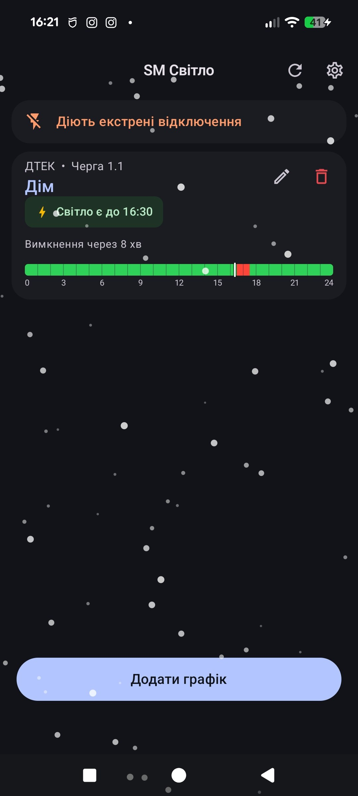
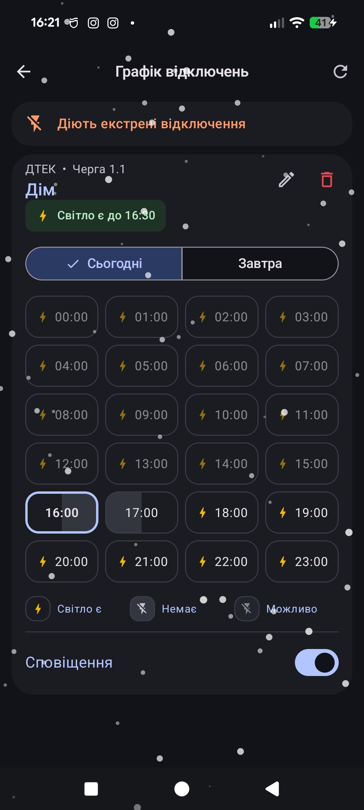
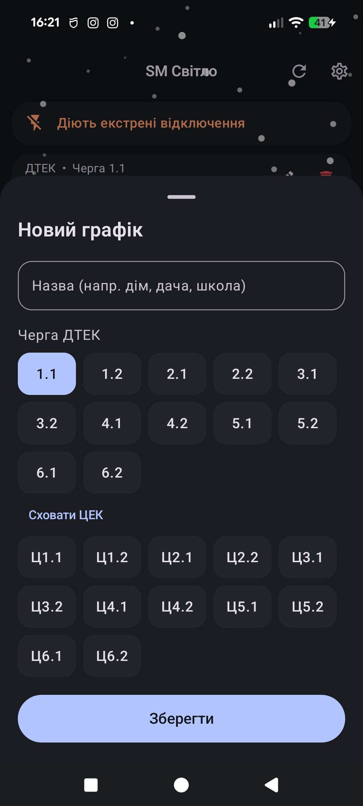
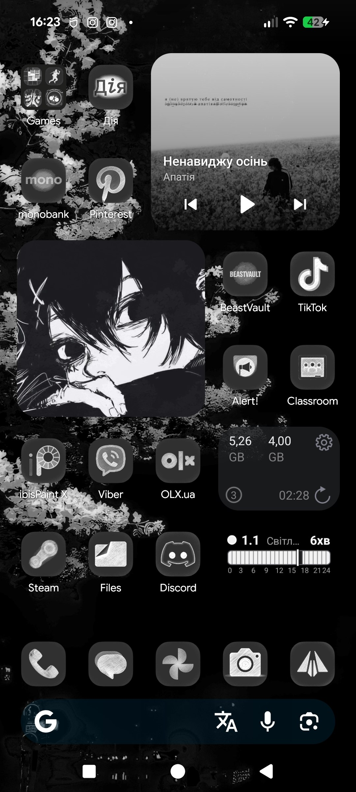
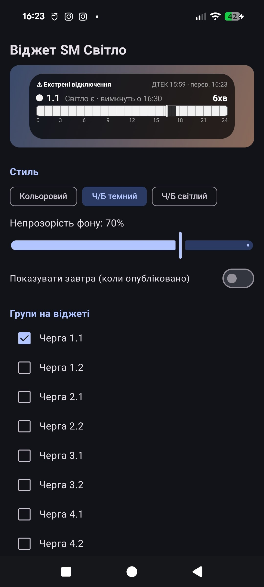
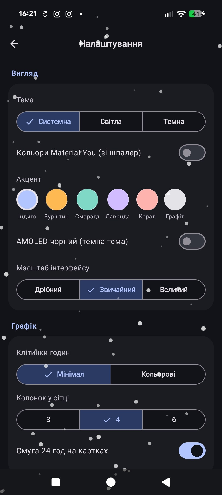
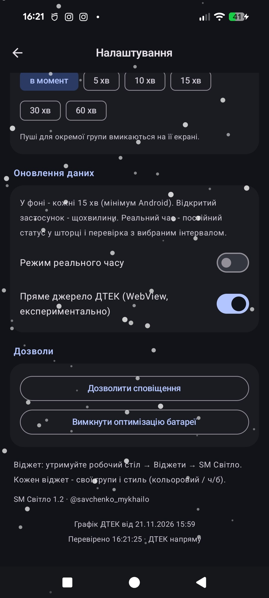

# SM Svitlo

[Українська](README.uk.md)

An Android app with DTEK Dnipro power outage schedules. Shows when the power goes off and on for your outage group, sends a reminder before it happens and has a home-screen widget.

  
  
  
  

## Features

- Several schedules at once, each with its own name and group (home, dacha, school), including the ЦЕК groups
- Current status ("power on until 16:30") and time until the next change
- Hour grid for today and tomorrow (when DTEK publishes it), with "on", "off" and "possible" states
- Warning banner when emergency outages are in effect
- Reminders before an outage or restore: at the moment, or 5, 10, 15, 30, 60 minutes before, set per group
- Home-screen widget with a 24-hour bar: color, dark or light black-and-white style, background opacity, chosen groups
- Background updates every 15 minutes, every minute while the app is open, plus an optional real-time mode with a persistent status notification
- Themes: system, light, dark, AMOLED black, Material You colors, six accent colors, UI scale

  
  
  

## Data source

Schedules come from the open [outage-data-ua](https://github.com/Baskerville42/outage-data-ua) dataset (`data/dnipro.json`). There is also an experimental option to read the DTEK website directly through a WebView.

## Tech

- Kotlin, Jetpack Compose, Material 3
- WorkManager for background sync, AlarmManager for exact reminders, a foreground service for real-time mode
- minSdk 26, targetSdk 35, version 1.2
- Unit tests for the schedule logic and screenshot tests with Paparazzi (`app/src/test`)

## Build

1. Android SDK 35 and JDK 17.
2. Create `local.properties` with `sdk.dir=/path/to/android-sdk`.
3. To sign a release build, copy `keystore.properties.example` to `keystore.properties` and fill it in.
4. `./gradlew assembleRelease`, tests: `./gradlew test`.

## Author

S-Mykhailo - [@savchenko_mykhailo](https://t.me/savchenko_mykhailo)

## License

GPL-3.0-or-later. You can use, change and share this code, but any modified version you distribute must also be open source under the GPL. See [LICENSE](LICENSE). Not affiliated with DTEK.
