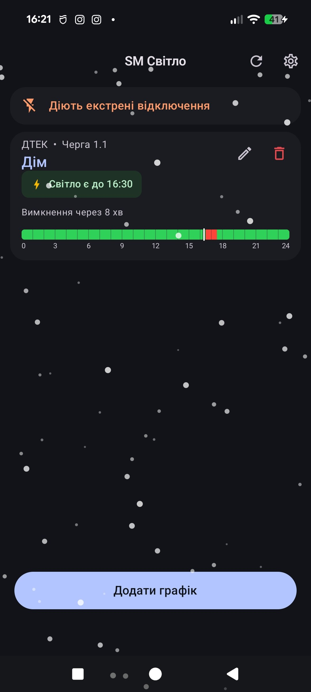
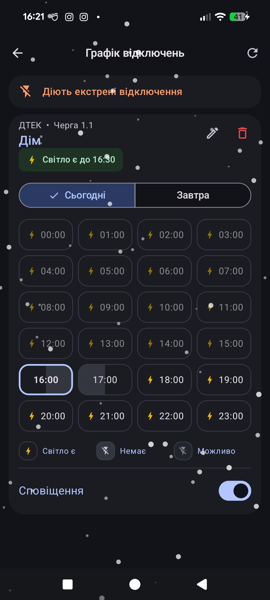
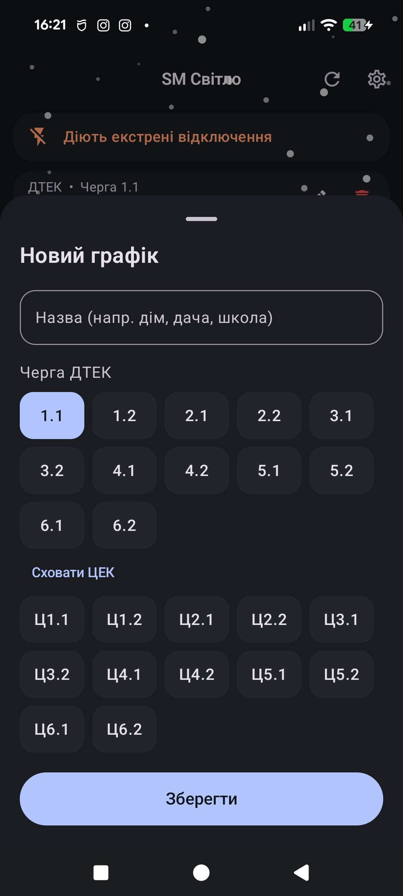
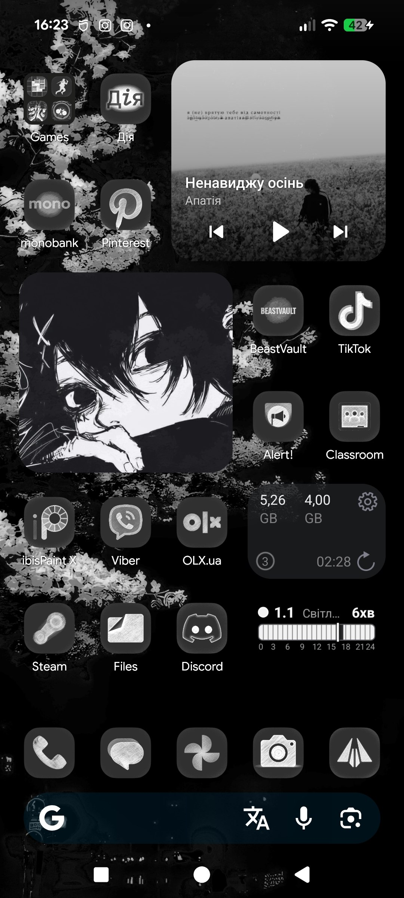
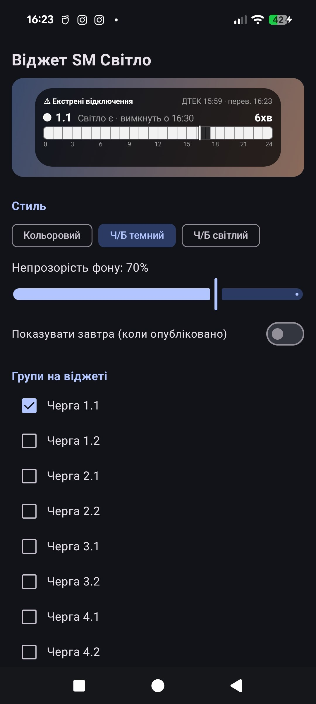
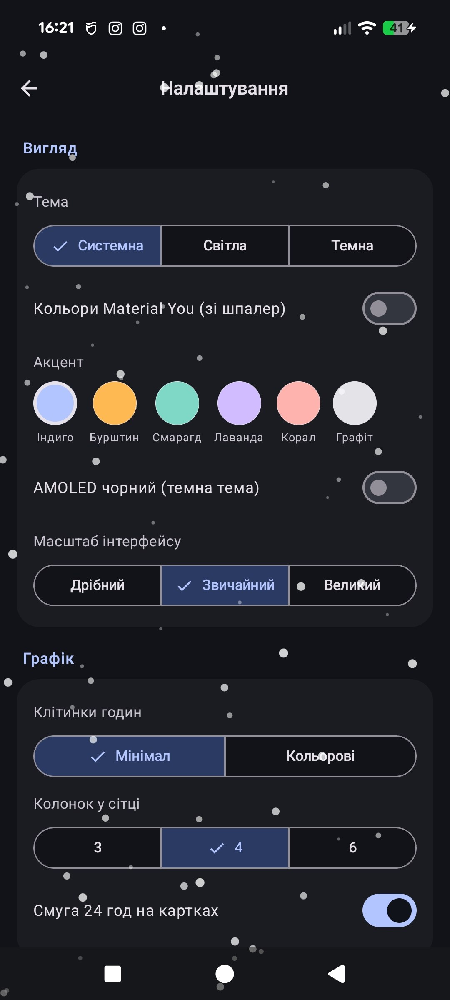
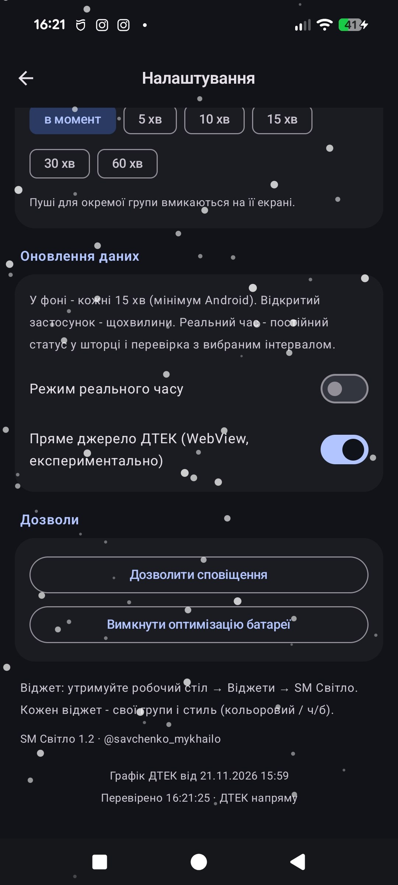

# SM Світло

[English](README.md)

Android-застосунок з графіками відключень ДТЕК Дніпро. Показує, коли вимкнуть і ввімкнуть світло для твоєї черги, нагадує заздалегідь і має віджет на робочий стіл.

  
  
  
  

## Можливості

- Кілька графіків одночасно, кожен зі своєю назвою і чергою (дім, дача, школа), є черги ЦЕК
- Поточний стан ("Світло є до 16:30") і скільки лишилось до зміни
- Сітка годин на сьогодні і завтра (коли ДТЕК його опублікує) зі станами "світло є", "немає", "можливо"
- Банер, коли діють екстрені відключення
- Нагадування перед вимкненням або ввімкненням: в момент, за 5, 10, 15, 30, 60 хв, окремо для кожної черги
- Віджет зі смугою на 24 години: кольоровий, ч/б темний або ч/б світлий, прозорість фону, вибір черг
- Оновлення у фоні кожні 15 хв, щохвилини коли застосунок відкритий, і режим реального часу з постійним статусом у шторці
- Теми: системна, світла, темна, AMOLED чорна, кольори Material You, шість акцентів, масштаб інтерфейсу

  
  
  

## Звідки дані

Графіки беруться з відкритого набору [outage-data-ua](https://github.com/Baskerville42/outage-data-ua) (`data/dnipro.json`). Є також експериментальний режим, який читає сайт ДТЕК напряму через WebView.

## Технічне

- Kotlin, Jetpack Compose, Material 3
- WorkManager для фонового оновлення, AlarmManager для точних нагадувань, foreground service для режиму реального часу
- minSdk 26, targetSdk 35, версія 1.2
- Юніт-тести логіки графіка і скріншот-тести на Paparazzi (`app/src/test`)

## Збірка

1. Android SDK 35 і JDK 17.
2. Створи `local.properties` з рядком `sdk.dir=/шлях/до/android-sdk`.
3. Щоб підписати release-збірку, скопіюй `keystore.properties.example` у `keystore.properties` і заповни.
4. `./gradlew assembleRelease`, тести: `./gradlew test`.

## Автор

S-Mykhailo - [@savchenko_mykhailo](https://t.me/savchenko_mykhailo)

## Ліцензія

GPL-3.0-or-later. Код можна використовувати, змінювати і поширювати, але будь-яка змінена версія, яку ти поширюєш, теж має бути відкритою під GPL. Див. [LICENSE](LICENSE). Застосунок не пов'язаний з ДТЕК.
